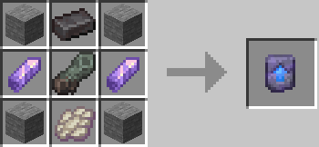

На сервере вы сможете увидеть новые необычные механики создания и предметы.

Все рецепты вам предстоит узнать самим, собирая записки в разных частях света: жители, данжи, сундуки сокровищ и т.д. Исключениями будут крафты что доступны всем.
# Оружие сервера

### 1. Большой Топор — удар по площади
**Активация:** ПКМ. Топор подбрасывает владельца, ненадолго задерживает его в воздухе, а затем обрушивает вниз. Огненная волна наносит урон и отбрасывает цели в радиусе **8 блоков**. Во время приёма владелец защищён от урона при падении.  
**Перезарядка:** 8 секунд. **Когда применять:** когда несколько целей уже собрались вокруг тебя.
### 2. Вампирский Клинок — восстановление здоровья в ближнем бою
**Активация:** ПКМ. Кровавые нити цепляют цели в радиусе **3 блоков** и вытягивают их здоровье, восстанавливая здоровье владельца. Связь можно разорвать, отойдя от владельца. Обычные удары клинком также имеют **25% шанс** восстановить полсердца.  
**Перезарядка нитей:** 15 секунд. **Когда применять:** когда рядом несколько целей и есть возможность удержаться поблизости.
### 3. Ветреная Булава — воздушная атака и отбрасывание
**Активация:** ПКМ с земли. Вихрь подбрасывает владельца и стягивает ближайшие цели. **Удар булавой в воздухе** выпускает волну вокруг поражённой цели: она подбрасывает и отталкивает окружающих в радиусе **5 блоков**. Во время приёма урон от падения не наносится.  
**Перезарядка:** 12 секунд. **Когда применять:** чтобы разорвать окружение. Само приземление без удара волну не запускает.
### 4. Громовой Лук — точечный разряд или гроза по площади
**Переключение режима:** Shift+ПКМ.
- **Разряд.** Особая стрела наносит цели **тройной урон**, ненадолго замедляет её и вызывает разряд, задевающий соседние цели в радиусе **2 блоков**. Перезарядка — **15 секунд**.
- **Метка.** Стрела отмечает цель или место попадания. В течение **10 секунд** нажми ПКМ с луком в руке, чтобы вызвать грозу вокруг метки. Метка на живой цели движется вместе с ней. Перезарядка после вызова грозы — **25 секунд**.
**Когда применять:** «Разряд» — для сильного попадания по одной цели; «Метка» — чтобы поймать несколько целей в одном месте.
## 5. Кинжал Душ
*Оружие ближнего боя, которое усиливается с каждым добиванием. Накопленные души можно сохранить ради урона и добычи или потратить на рывок.*
**Пассивная способность — Сбор душ**
Добивания кинжалом дают по одной душе. Кинжал хранит до **5 душ**. Каждая душа добавляет **6% к урону ближних ударов этим кинжалом**. На другое оружие и снаряды бонус не переносится.

| Души | Бонус к урону | Добыча               |
| ---- | ------------: | -------------------- |
| 0    |             — | Исходное зачарование |
| 1–2  |        +6–12% | Не ниже II           |
| 3–4  |       +18–24% | Не ниже III          |
| 5    |          +30% | Не ниже IV           |
### Активная способность — Шаг сквозь тень
**ПКМ при пяти душах** расходует весь заряд и даёт короткий рывок вперёд. Рывок сам не наносит урона и не переносит сквозь стены.
В течение **2 секунд** первый успешный прямой удар **тем же кинжалом по мобу** возвращает **3 души**. Возврат срабатывает один раз за рывок. Удар по игроку или другим оружием души не вернёт.
**Когда применять:** если цель уже в радиусе удара, выгоднее сохранить полный заряд. Если до неё не хватает дистанции, рывок позволяет достать её и сразу вернуть часть усиления
### 6. Клинок Охотника — добивание с переходом на дальний бой
**Активация:** добей цель клинком. Ты получишь **Призрачный арбалет** с невидимой стрелой. Арбалет рассчитан на **один выстрел** и исчезает после него или через **30 секунд**, если не воспользоваться им. Попадание накладывает замедление, слабость и слепоту.  
**С первым патчем:** арбалет получает **«Добычу IV»**, **«Пронзание IV»** и сохраняет **«Быструю перезарядку III»**. Выпущенную стрелу нельзя подобрать. **Когда применять:** добей слабую цель клинком, затем выстрели вдоль ряда противников, чтобы использовать пронзание.
### 7. Меч Фантома — один удар превращается в контратаку
**Активация:** добей цель мечом, чтобы получить **Призрачный щит** на срок до **30 секунд**. Пока щит в левой руке, он поглощает один боевой удар и рассеивается, отбрасывая и замедляя ближайшие цели.  
**С первым патчем:** щит также отменяет урон от падения. Падение **не тратит щит, не вызывает волну и не обновляет его таймер**. **Когда применять:** добей слабую цель, прежде чем вступить в бой с более опасной.
### 8. Теневая Катана — призыв ценой здоровья
**Активация:** ПКМ, когда поблизости есть подходящая цель. Катана забирает **половину текущего здоровья** и призывает **трёх теневых псов** на срок до **15 секунд**. Если здоровья слишком мало или рядом нет цели, призыв не сработает.  
**Перезарядка:** 20 секунд. **Когда применять:** в начале схватки, когда есть время воспользоваться помощью псов, а не в момент, когда надо пережить следующий удар.
### 9. Трезубец Бездны — стягивание целей
**Активация:** попади по живой цели броском или ударом в ближнем бою. У цели открывается воронка на **3 секунды**. Она стягивает существ в радиусе **3 блоков**, периодически ослепляет их и наносит урон, пока они остаются внутри.  
**Перезарядка:** 12 секунд. **Когда применять:** чтобы собрать рассеянные цели под следующую атаку по площади.
### 10. Цепной Лук — удержание группы
**Активация:** попади особой стрелой по цели. Первый удар наносит **в 1,5 раза больше урона**, после чего разряд перескакивает на соседние цели. Поражённые цели на срок до **3 секунд** оказываются скованы и получают периодический урон.  
**Перезарядка:** 6 секунд. **Когда применять:** целься в того, кто стоит среди группы: в отличие от Громового Лука, здесь главное — удержать несколько целей, а не усилить один выстрел.

# Рецепты оружия:
**Трезубец Бездны**  
Положи на алтарь оружие с тремя зубцами. Дай ему одно сердце моря и одну звезду из Незера. Пусть два осколка повторят эхо глубин, а две раковины наутилуса запомнят его.
**Кинжал Душ**  
Начни с одного железного меча. Закали его четырьмя слитками незерита и двумя обломками того же металла. Укрась четырьмя алмазами, вложи одно сердце моря и одну звезду Незера. Восемь жемчужин из Края укажут душам дорогу.
**Теневая Катана**  
Одному незеритовому мечу дай шесть слитков того же металла и одну звезду Незера. Окружи клинок шестнадцатью фиолетовыми осколками и шестнадцатью порциями дыхания дракона. Четыре перепонки тех, кто охотится на неспящих, завершат обряд.
**Вампирский Клинок**  
На алтарь положи один незеритовый меч, шесть слитков незерита и одну звезду из его мира. Добавь одно золотое яблоко, сияющее чарами, и два зелья, что разбиваются при броске. Последними отдай шестнадцать паучьих глаз — не сырых, а маринованных.
**Цепной Лук**  
Одному луку, что прежде метал лишь стрелы, дай тридцать два слитка железа, шестнадцать слитков меди и четыре алмаза. Последним положи один стержень, что на крыше ловит молнию.
**Клинок Охотника**  
Возьми один алмазный меч и закали его тремя слитками незерита. Добавь одну звезду Незера, четыре порции дыхания дракона и две кроличьи лапки — на удачу в погоне.
**Меч Фантома**  
Одному незеритовому мечу дай шесть слитков того же металла, шестнадцать алмазов и одну звезду Незера. Восемь жемчужин Края проложат путь сквозь тьму. Шестнадцать перепонок фантома и шестнадцать сгустков смолы свяжут клинок с теми, кто летает над бессонными.

Пробужденный шаблон: 

 “Огурец” посередине падает с Визера.
Шаблон необходим для создания совмещенных элитр с нагрудником.
Поддерживаются все нагрудники, отделки и чары. 
![[1.png]]
 Блок света: 
![[2.png]]
 Буханка хлеба: 
![[3.png|265]]
 Угольный блок из древесного угля: 
![[4.png|265]]
 Лавовая губка: 
![[sponge.png|265]]
 Губка: 
![[sponge(1).png|265]]
